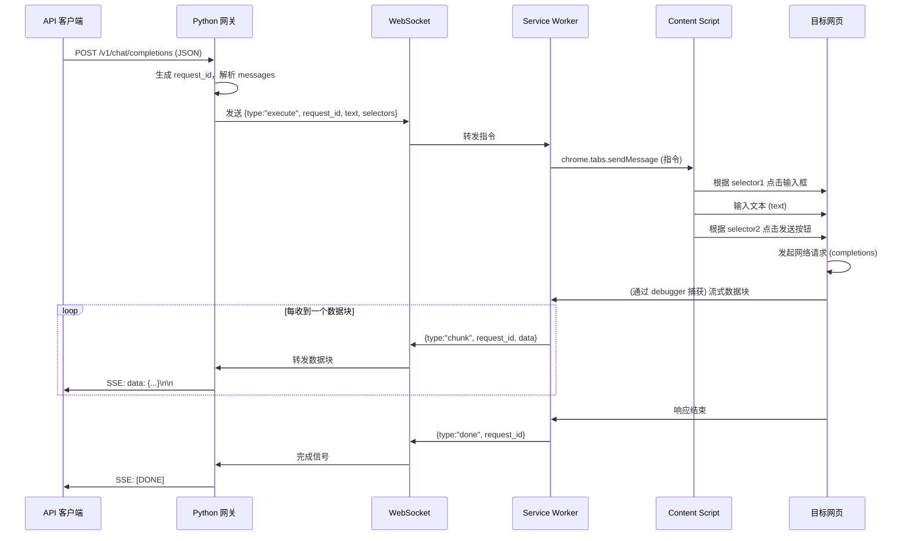

> [← 返回文档目录](../README.md) ｜ 本分册由 `README.md` 的「4. 数据流与交互流程」章节拆分而来。

## 4. 数据流与交互流程

### 4.1 初始化阶段
1. 用户启动 Python 服务，服务开始监听 8080 端口并启动 WS 服务器。
2. 用户打开 Chrome 浏览器，加载扩展程序，扩展自动与 Python 服务建立 WebSocket 连接。
3. 用户导航至目标 AI 网站并登录，确保页面可用。

### 4.2 单次请求处理流程

### 4.3 异常处理
- 若扩展未连接，Python 返回 503 错误。
- 若操作超时（如未捕获到请求），Python 返回超时错误，并清理状态。

---
